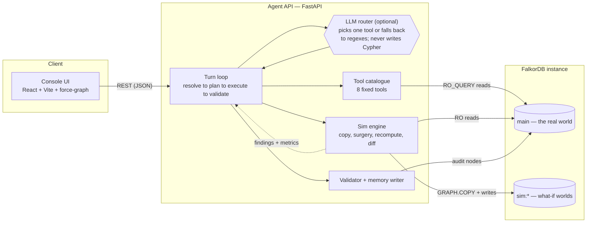
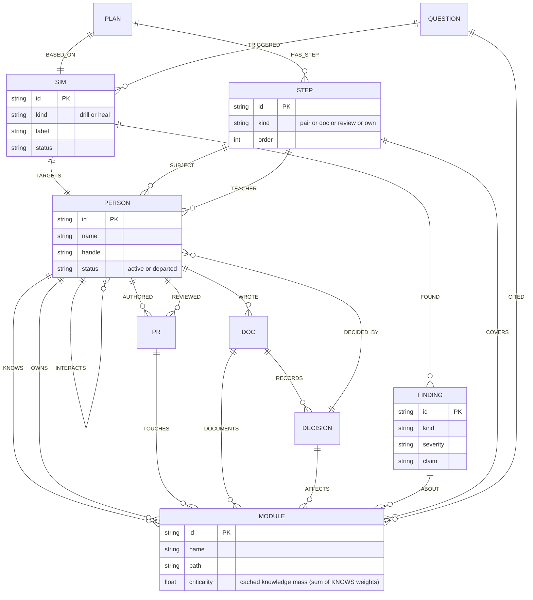
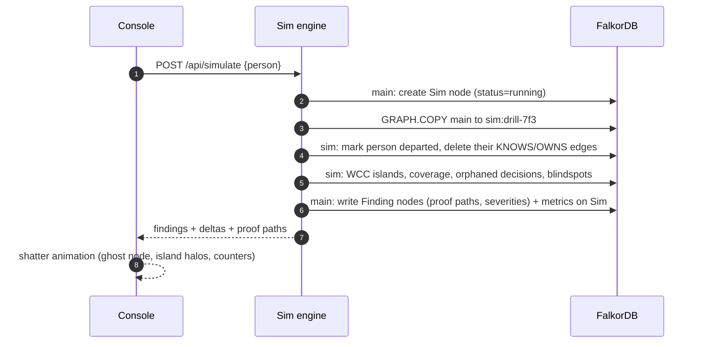
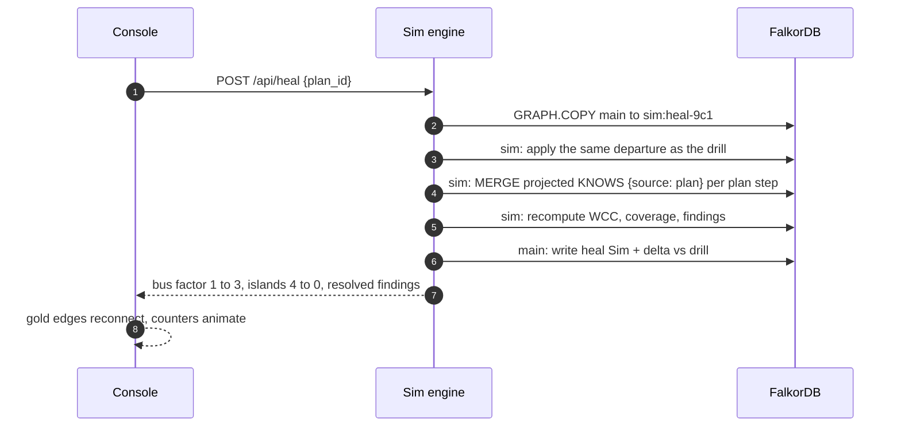
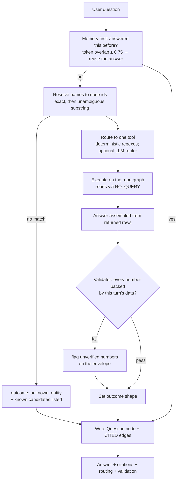

<div align="center">

# BusFactor

**Know who your team can't lose — and fix it before they leave.**

*Everyone measures the bus factor. BusFactor simulates it — and heals it.*


</div>

> **What this is.** A knowledge-graph agent that maps who knows what across a repository, **simulates losing a person** on a clone of the graph, produces a **handover plan**, and **proves the fix by re-running the same simulation with the plan applied** — then renders the action it would take (preview-first, repo-scoped) and exposes the same tool catalogue over **MCP** so any coding agent can consult it.
>
> **The name.** *Bus factor* = how many people the project can lose before it's in trouble. For most teams it's 1. BusFactor makes that number something you can **rehearse — and raise**.
>
> This single document is the product and system specification.

## Contents

1. [The problem](#1-the-problem)
2. [Philosophy: six principles](#2-philosophy-six-principles)
3. [Features: what you see, what the graph computes, why](#3-features-what-you-see-what-the-graph-computes-why)
4. [Glossary: speak the language](#4-glossary-speak-the-language)
5. [Architecture and invariants](#5-architecture-and-invariants)
6. [Graph data model](#6-graph-data-model)
7. [Simulation engine](#7-simulation-engine)
8. [The agent, the trust layer, memory](#8-the-agent-the-trust-layer-memory)
9. [FalkorDB utilization map](#9-falkordb-utilization-map)
10. [API, console, actions, MCP, deployment](#10-api-console-actions-mcp-deployment)
11. [Non-goals](#11-non-goals)

---

## 1. The problem

A team's fragility doesn't live in its people — it lives in the **edges** between them and everything else: the engineer who is the only bridge between two subsystems, the decision that exists in exactly one head because no ADR was ever written, the module three people *touch* but only one *understands*. None of these can be read off a person, a file, or a score. They are properties of the network around a person.

| Today's attempt | What it gives you | What it can't |
|---|---|---|
| Org chart | Who reports to whom | Reporting lines aren't dependence lines. Says nothing about knowledge. |
| Git dashboards (busfactor.tech, Mapnostics, truck-factor research) | A static concentration metric ("your bus factor is 1") | Activity ≠ dependence. Blind to reviews, decisions, docs. No consequences, no what-if, no fix. |
| Chat-with-the-repo (text RAG) | Fluent summaries of docs | No mechanism for consequence: asked "what if X leaves", it answers with a confident guess. No proof for any claim. |
| A human audit | A snapshot opinion, once | Stale the day it's written; humans can't introspect graph structure anyway. |

Aviation has simulators. Surgery has drills. Infrastructure has game days. Knowledge loss is the one crew-ending event nobody rehearses — not because teams don't care, but because until now there was no way to run the drill. **You can't game-day a resignation. You can simulate one.**

## 2. Philosophy: six principles

**P1 · Risk lives on edges, not nodes.** Bus factor is not a property of a person; it's a property of the graph around them. You can't read it off a box — you have to look at the wires.

**P2 · You can't audit what you can't remove.** Metrics give numbers and guilt. Consequences require experiment: remove the person and watch — on a copy of the world, where nothing real is harmed.

**P3 · A rehearsal beats a report.** Every high-stakes discipline rehearses its failure modes because rehearsal is cheaper than failure. BusFactor is that missing drill, for knowledge.

**P4 · Diagnosis without a plan is a horoscope.** The simulation ends in an ordered handover plan — and then **re-runs the disaster with the plan in place**. We don't trust the plan. We test it.

**P5 · An answer you can't audit is an oracle.** Every claim cites the exact hops that prove it; every number is validated against rows the database actually returned; refusals are first-class.

**P6 · The graph is the physics.** Copy worlds, remove nodes, recompute connectivity and centrality, diff worlds — this is graph computation, not an app over a database. Remove FalkorDB and BusFactor doesn't get slower; it stops being possible. Every feature must clear this bar.

## 3. Features: what you see, what the graph computes, why

| Feature | What the user sees | What the graph computes | Why it's like that |
|---|---|---|---|
| **Any repo** | Paste a GitHub URL — or point at a local clone — and it is indexed into its own graph; every feature below then runs on it | One FalkorDB graph per repo (`repo:<slug>`), a small registry graph tracks ingest status and stats | A product has to run on *your* repo, not the demo's |
| **Knowledge map** | Interactive graph of people ↔ modules ↔ docs ↔ decisions | Derived `KNOWS` edges, recency-weighted from commits, reviews, issue references, CODEOWNERS | Risk lives on edges (P1) — you must see the wires, not boxes |
| **Load-bearing people** | Ranked list + evidence paths per name | Sole-knower tallies + knowledge-mass rollup (`sum(KNOWS.weight)`); bridges surface as component splits during drills | A ranked *prior* — the drill is the ground truth (P2) |
| **What-if simulation** | Pick a person → "Run simulation" | `GRAPH.COPY` → `sim:<id>`; remove their `KNOWS`/`OWNS` edges; recompute components/coverage; diff vs main | You can't audit what you can't remove (P2) |
| **Knowledge islands** | "4 islands — 23 modules left with zero knowers" | WCC on G_k before vs after (isolates are size-1 components) | The shatter, made measurable and clickable |
| **Decisions at risk** | "These 2 decisions lose their only owner" | Pattern match over `DECIDED_BY` + absence of a `RECORDS` doc | Rationale loss is silent and unrecoverable — worth its own signal |
| **Handover plan** | Successor pairs + rationale ("they already carry the sibling modules", "they worked the same tree") | Sibling-tree mass over weighted `KNOWS` (cost = 1 − weight) + shared working history with the departing person | Diagnosis must end in a plan (P4) |
| **Heal loop** | "Re-simulate after plan" → shatter reverses, counters move | Projected `KNOWS {source:'plan'}` edges in a fresh clone; algorithms re-run; metrics recomputed and diffed | Proof, not promise: re-run the disaster with the fix in place (P4) |
| **Memory** | Past simulations with dates and trend ("weakest node moved from X to Y"); recalled at session start | `Sim`/`Finding`/`Question` nodes written back; `CITED` edges; traversal + token-overlap recall | Institutional memory of risk; memory = more nodes, not vectors |
| **Actions** | "Open handover issue" → a real GitHub issue + runbook PR draft appears | Plan steps + evidence paths → GitHub payload (scoped token, preview by default) | Closes the loop from diagnosis to action — agents that *act* |
| **MCP server** | Use BusFactor from Claude Code / Cursor | The same 9-tool catalogue exposed over MCP — one implementation, two surfaces | Meet developers where they work; FalkorDB-native pattern |

**The loop:** Ingest → Ask → Drill (shatter) → Proof (click) → Plan → Act (issue/PR) → Heal (re-simulate, verify) → Remember (next session starts smarter).

## 4. Glossary: speak the language

| Term | Meaning |
|---|---|
| **Bus factor** | The number of people a project can lose before it's in trouble. Per module: count of active people who can work on/explain it. Team bus factor: the minimum across modules. |
| **KNOWS edge** | Person → Module relationship, weight 0–1, tagged `source: traced / inferred / plan`. The core derived fact of the system. |
| **G_k (knowledge view)** | Subgraph `{Person, Module, Doc}` + `{KNOWS, OWNS, DOCUMENTS}` — the view all connectivity analysis runs on. |
| **Knowledge island** | A WCC component of G_k with ≥1 module and **0 active people**: nobody remaining can explain it. |
| **Sole knower / load-bearing person** | The only active person connected to a module (its bus factor is 1) / a person whose removal shatters large regions of the graph. |
| **Bridge** | A person whose removal splits G_k into ≥2 components that each contain people. |
| **Orphaned decision** | A `Decision` with no active decider **and** no doc recording its reasoning. |
| **Review blindspot** | A module with recent PR activity whose reviewers have all departed. |
| **Drill** | One what-if simulation: clone world → remove person → recompute → diff. Visual: the shatter. |
| **Heal** | Apply the plan as projected edges in a fresh world, re-run the same drill, measure the delta. |
| **World** | One FalkorDB graph: `main` (observed reality) or `sim:<id>` (a what-if). Kept for replay. |
| **Projected edge** | A hypothetical knowledge edge from the plan, `source:'plan'`, existing **only inside sim worlds**, rendered gold. |
| **Finding** | A claim produced by a drill (island, sole-knower, orphaned decision…) with severity + proof paths. |
| **Outcome shape** | Label on every answer: `answered_with_path` / `answered_from_memory` / `not_in_graph` / `unknown_person`. |
| **Show your work** | The audit panel: which tool ran, on which world, with which query, in how long, returning what. |

## 5. Architecture and invariants



| Component | Tech | Responsibility |
|---|---|---|
| Console UI | React 18 + Vite (JSX) + `react-force-graph-2d` | World switcher, ask / drill / plan / heal flows, evidence panel, dark & light themes. Canvas for 60fps at thousands of edges. |
| Agent API | Python 3.12 + FastAPI + official `falkordb` client | Turn loop, tool execution, validation, memory. Python client is first-class for `algo.*`, `GRAPH.COPY`, `RO_QUERY`. |
| Tool catalogue | 9 tools; queries as versioned `.cypher` files | The only graph access the agent has. |
| Sim engine | `GRAPH.COPY` + Cypher surgery + algorithm recompute + diff | Drill/heal worlds. |
| FalkorDB | Docker image / FalkorDB Cloud | `main` + `sim:*` worlds — the substrate. |
| LLM | OpenAI-compatible endpoint (env-configured; any gateway with app-callable free models, e.g. OpenRouter `:free`) | One job: route a question to one of the 9 tools. Deterministic regexes are the fallback and the default. No Cypher, no numbers, no ingestion. |

**Invariants — the constitution. If a feature can't satisfy these, the feature changes:**

| # | Rule | Why |
|---|---|---|
| I1 | FalkorDB is the substrate, not the storage. Every capability lands as graph computation. | The "remove the graph and it stops being possible" bar. |
| I2 | The LLM never writes Cypher. Only the frozen 9-tool catalogue; queries are versioned files. | Determinism, audit, injection safety, explainability. |
| I3 | Worlds are isolated. `main` is never mutated by agent flows; drills/heals live in `sim:<id>`; projected edges only there, tagged `source:'plan'`. | What-if must never contaminate the record. |
| I4 | Every answer cites evidence returned this turn; refusals are first-class. | An answer you can't audit is an oracle. |
| I5 | Everything deterministic: sha256-pinned snapshot, fixed algorithm seeds (`samplingSeed 42`), pinned demo scenario. | Reproducible benchmark; reliable results. |
| I6 | Reads are read-only (`ro_query`), everywhere except inside sim worlds. | Blast-radius containment. |
| I7 | Main-graph writes are additive and auditable only: ingest output + audit nodes (Question/Sim/Finding/Plan/Step). No destructive ops outside sims. | History is append-only. |
| I8 | External actions (GitHub writes) are preview-first, token-scoped, and never target third-party repos. | Acting on reality must never risk anyone else's data. |
| I9 | One implementation per capability: MCP tools wrap the *same* functions as the HTTP API. | One code path, one truth. |

## 6. Graph data model



**Node properties (only what's used):** `Person {id, name, handle, role?, status, first_seen, last_seen}` · `Module {id, name, path, commits_window, criticality}` · `Doc {id, path, title, kind}` · `Decision {id, title, status, decided_at, source_path}` · `PR {number, title, merged_at, files_changed}` · `Sim {id, kind, label, target_person, status, created_at, metrics_json}` · `Finding {id, kind, severity, claim, proof_json, created_at}` · `Plan {id, label, target_person, status, created_at}` · `Step {id, kind, order, note}` · `Question {id, text, outcome, created_at}`.

**Edge properties:** `KNOWS {weight 0..1, source: traced/inferred/plan, cost = 1 − weight, last_at}` · `OWNS {since, source}` · `AUTHORED {commits}` · `REVIEWED {reviews, last_at}` · `TOUCHES {files, additions}` · `INTERACTS {n, last_at}` · audit edges `TARGETS, FOUND, ABOUT, HAS_STEP, BASED_ON, SUBJECT, TEACHER, COVERS, CITED, TRIGGERED`.

**G_k for islands** = nodes `{Person, Module, Doc}`, edges `{KNOWS, OWNS, DOCUMENTS}`. Decisions are analyzed by their own query (owner + records), because "who can explain this" and "does this decision still have an owner" are different questions. `INTERACTS` is excluded from G_k — it merges people, not explainability.

**Provenance — what a repo must have.** The only hard requirement is `git log`. Everything else is optional enrichment:

| Input | Required? | If missing |
|---|---|---|
| Commit history | **Yes** | Nothing to analyze — this is the substrate |
| CODEOWNERS | No | `OWNS` falls back to top-committer share (≥ 35% of a module's commits); both paths write `source` on the edge, so you can always tell which rule fired |
| Pull requests | No | Review channel omitted; weight formula renormalizes over commits + recency |
| Review activity | No | Needs a `GITHUB_TOKEN` for private repos / rate limits; tokenless public indexing still gets PR titles and authors |
| Docs & ADRs | No | Decision findings are simply absent; coverage findings are unaffected |

A repo that has *only* commit history gets the full drill → plan → heal arc. Enrichment sharpens the graph; it never gates the analysis.

```cypher
// indexes (created by the loader)
CREATE INDEX FOR (p:Person) ON (p.name)
CREATE INDEX FOR (m:Module) ON (m.id)
CREATE INDEX FOR (m:Module) ON (m.name)
CREATE INDEX FOR (d:Doc) ON (d.path)
```

## 7. Simulation engine

**Pinned definitions:**

```
R(m)              = |{ p : Person, p.status='active', (p)-[:KNOWS|OWNS]->(m) }|  // module coverage
module bus factor = R(m)
team bus factor   = min over modules with R(m) > 0 in main (pre-existing zeros tracked separately)
island(sim)       = WCC component of G_k with >=1 Module and 0 active Persons
sole_knower_lost  = R(m) was 1 in main, now 0
orphaned_decision = Decision with 0 active DECIDED_BY and 0 Doc RECORDS
review_blindspot  = Module active in window whose reviewers all departed
bridge_lost       = departure splits G_k into >=2 components that each contain an active Person
coverage_thin     = R(m) dropped below K (K=2) but stayed > 0
was_already_blind = R(m)=0 in main too — reported separately, never blamed on the departure
```

**Drill:**



**Surgery rule:** the person is *marked*, not deleted — artifacts (PRs, docs, reviews) keep attribution; only knowledge-carrying edges (`KNOWS`, `OWNS`) are removed in the clone. All coverage queries filter `status='active'`. Consequences flow through ordinary queries: we don't special-case the departed — reality simply no longer contains them.

**Heal:**



**Limits:** ≤ 32 concurrent worlds; `make clean-sims` prunes. Demo graph budget ≤ 3k nodes / ≤ 12k edges (12-month window + thresholds) → every drill < 10 s. Clone strategy: `GRAPH.COPY` (capability probed at startup via `/api/health`); fallback = replay the deterministic loader into the new graph (same graph by construction).

## 8. The agent, the trust layer, memory



**Tool catalogue — frozen at nine:**

| Tool | Engine | Returns | Why |
|---|---|---|---|
| `who_knows(module, limit=5)` | `KNOWS`/`OWNS` + review channel (`REVIEWED`→`PR`→`TOUCHES`) | Ranked people with evidence paths per channel | The primitive question; proves answers are traceable |
| `relations(ref)` | Shared-ground join over `KNOWS`/`OWNS`, `AUTHORED`/`REVIEWED`, `DECIDED_BY`, `WROTE` | Pairwise overlap for 2–4 people: shared modules (joint familiarity = Σ min weight), PRs, decisions, docs | "How are A, B and C connected" answered from the graph, not vibes |
| `critical_people(limit=5)` | Knowledge mass (`sum(KNOWS.weight)`) + sole-knower tallies over coverage | Ranked persons + reason (sole knower / breadth) | A fast prior — and it says so; ground truth comes from drilling |
| `knowledge_islands(world)` | `algo.WCC` on G_k | Components with modules but no active persons | The shatter, made measurable |
| `module_risk(module)` | Aggregation over `KNOWS`/`REVIEWED`/`DECIDED_BY` | Coverage, reviewers, doc safeties, orphaned decisions | Module-level verdict, not vibes |
| `simulate_departure(person)` | Sim engine (§7) | `sim_id`, findings, deltas | The differentiator — an action, not a report |
| `handover_plan(person, sim_id)` | Successor scoring (sibling mass + shared history) + `algo.SPpaths` bridge path per step | Ordered steps with named teachers + proof | Diagnosis must end in a plan |
| `heal_and_verify(plan_id)` | Sim engine (§7) | Before/after deltas, resolved findings | The proof, not the promise |
| `recall(query)` | `Question`/`CITED`/`Sim` traversal | Prior questions, findings, outcomes | Memory = more nodes |

**Core query templates** (production versions live in `agent/.../queries/*.cypher`; validated against FalkorDB's Cypher subset during implementation):

```cypher
// who_knows — params: $module_id, $limit
MATCH path = (p:Person {status:'active'})-[k:KNOWS|OWNS]->(m:Module {id:$module_id})
RETURN p.name AS person, type(k) AS channel, k.weight AS strength, k.source AS provenance,
       [n IN nodes(path) | coalesce(n.name, n.path)] AS hops
ORDER BY strength DESC LIMIT $limit
```

```cypher
// knowledge_islands — run inside a world graph
CALL algo.WCC({
  nodeLabels: ['Person','Module','Doc'],
  relationshipTypes: ['KNOWS','OWNS','DOCUMENTS']
}) YIELD node, componentId
WITH componentId, collect(node) AS members
WHERE none(x IN members WHERE x:Person AND x.status = 'active')
  AND any(x IN members WHERE x:Module)
RETURN componentId, [x IN members | coalesce(x.name, x.title)] AS stranded
```

```cypher
// handover bridge — params: $teacher_id, $module_id (runs per plan step)
// how the teacher's knowledge reaches the module: Person → Module → Person → Module
MATCH (t:Person {id:$teacher_id}), (m:Module {id:$module_id})
CALL algo.SPpaths({
  sourceNode: t, targetNode: m, relTypes: ['KNOWS'],
  relDirection: 'both', weightProp: 'weight', pathCount: 1, maxLen: 5
}) YIELD path, pathWeight
RETURN [n IN nodes(path) | coalesce(n.name, n.path)] AS hops, pathWeight
```

**Outcome shapes** (first-class UX, shown as chips):

| Shape | Meaning |
|---|---|
| `answered_with_path` | Cites nodes/rows returned by the graph this turn |
| `answered_from_memory` | Reused a prior answer (repeat question, or `recall` hit) |
| `not_in_graph` | No evidence existed; the agent says so and explains why that matters |
| `unknown_entity` | Name resolved to nothing; known candidates are listed |
| `missing_input` | E.g. heal without a plan — the answer names the prerequisite |
| `bad_args` / `error` | Tool mis-invocation or failure — surfaced, never guessed around |

**Validator rules, in order:** (1) on answered outcomes only — refusals and errors assert nothing numeric and are exempt; (2) extract every number from the answer text; (3) each must match a value in the turn's returned data or citations within ±0.011; (4) answers format floats to 2 decimals so rounding always survives; (5) unbacked numbers flunk the envelope (`validated: false`), which the console shows as a badge. Names are protected by the tools themselves: answer templates only ever interpolate rows that came back from the graph.

**Memory:** each turn writes `Question {text, outcome, created_at}` + `CITED`/`TRIGGERED` edges. Session bootstrap: the console (and MCP server) opens with a recall summary — last sim, open findings, bus-factor trend ("weakest node moved from X to Y", computed by diffing consecutive drill metrics). `recall` resolves names first, then token-overlap over `Question.text`. Deterministic, auditable, no vector store.

**LLM contract:** input = question + resolved ids + tool schemas + world context. Output = **JSON only** (`{tool, args}`), schema-validated server-side before execution. Temperature low. Env: `LLM_BASE_URL`, `LLM_MODEL`, `LLM_API_KEY`. Refusal instruction: if tools return no evidence, the model must say so and must not estimate. Any OpenAI-compatible endpoint works — e.g. an OpenRouter `:free` model (`LLM_BASE_URL=https://openrouter.ai/api/v1`), which is callable from a normal app. (Caveat we verified: OpenCode Console's free-tier models only answer requests from inside the OpenCode client; other callers get `403 FreeTierError`.) Without an endpoint configured, the deterministic router is used and every flow in this README still holds.

**Benchmark — the honesty suite.** `make bench` replays twelve frozen tickets (`data/benchmark.yml`) through the real `ask()` loop on a reset graph: lookups, module risk, memory recall, a full drill → plan → heal arc, and three seeded refusals. Every ticket checks three things — the router picked the intended tool, the outcome shape matches, and every number survived the validator. Results land in [`results.md`](results.md). The suite is not decorative: it caught a real validator violation during development (a template printed a derived count that wasn't in its data envelope).

## 9. FalkorDB utilization map

| Capability | Used for | Why it's the right tool |
|---|---|---|
| **Multigraph** (graph per what-if) | Drill worlds, heal worlds, filmstrip | Every hypothetical is a fully isolated graph in one instance — the product *is* worlds |
| **`GRAPH.COPY`** | Clone `main` → `sim:<id>` | Server-side atomic snapshot; copies indexes too; source stays queryable during copy |
| **`algo.WCC`** (`nodeLabels`/`relationshipTypes` filters) | Knowledge islands + bridge detection | Linear-time components on G_k; a removal that raises the active-person component count is a measured bridge loss |
| **`algo.SPpaths`** (`both` direction over the bipartite view) | Handover bridge path | Shortest weighted Person→Module→Person→Module walk linking a teacher's knowledge to the target module; lands in every plan step's proof |
| **Knowledge-mass rollup** (`MATCH (m:Module)<-[k:KNOWS]-(p) … sum(k.weight)`) | Module criticality | Weighted in-degree = depended-upon knowledge; sizes nodes, weights plans. *(PageRank was tried first and degenerates to a near-uniform score on this bipartite view — verified empirically — so the direct rollup is the honest measure.)* |
| **Weighted `KNOWS` + set operations** | Handover rationale | Successor scoring = sibling-tree mass + shared history; an index-free O(E) fold over hundreds of edges, executed server-side |
| **`RO_QUERY`** | Every read | No read path can mutate anything |
| **Range indexes** | Entity resolution | Sub-ms lookups; verified via `GRAPH.EXPLAIN` |
| **`GRAPH.LIST` / `GRAPH.DELETE`** | Worlds housekeeping | Prune sims (`make clean-sims`) |

## 10. API, console, actions, MCP, deployment

**API surface** (every repo-scoped call takes a `repo` slug; the registry resolves it to a graph):

| Method | Path | Scope | Purpose |
|---|---|---|---|
| `GET` | `/api/health?repo=` | server | db ping, node/edge counts |
| `GET` | `/api/repos` | registry | every indexed repo, ingest status, settings |
| `POST` | `/api/repos` | registry | index `{source}` — GitHub URL or local clone path; background job |
| `GET` | `/api/config` | — | the configuration actually in force |
| `PUT` | `/api/config` | — | update ingest defaults (history window) |
| `GET` | `/api/overview?repo=` | repo | headline metrics, coverage, memory meta |
| `GET` | `/api/people?repo=` | repo | roster with commit mass |
| `GET` | `/api/timeline?repo=` | repo | sims + plans + worlds (the filmstrip) |
| `POST` | `/api/ask` | repo | grounded Q&A through the 9-tool catalogue |
| `POST` | `/api/drill` | repo→clone | run a drill `{person}`; writes findings + Sim |
| `POST` | `/api/plan` | repo | plan for `{sim_id}`; writes Plan + Step nodes |
| `POST` | `/api/heal` | repo→clone | apply `{plan_id}`, re-run the drill; writes heal Sim + delta |
| `POST` | `/api/actions` | repo | render the exact GitHub payload a live run would send (preview only, I8) |
| `GET` | `/api/findings?repo=&sim_id=` | repo | findings with proofs for any run |
| `GET` | `/api/memory?repo=` | repo | question log + counters |
| `GET` | `/api/graph?world=&repo=` | any | nodes + links + components for the canvas (`RO_QUERY`) |

**Console:**

```
┌────────────────────────────────────────────────────────────────────┐
│ BusFactor   • 322 nodes · 1087 edges · memory 4 · runs 2  [theme]  │
│ repo [main ▾]  [+ index a repo]                                    │
├───────────────────────────────┬────────────────────────────────────┤
│                               │ [Ask|Scenario|Findings|Memory]     │
│        graph canvas           │                                    │
│  (world morphs on switch;     │  ask card w/ citations · drill →   │
│   legend · selected node)     │  plan steps w/ rationale · heal    │
│                               │  deltas · findings, click to proof │
├───────────────────────────────┴────────────────────────────────────┤
│ worlds: [truth main · 32 modules] [drill-7f3 islands 11] [heal-9c1]│
└────────────────────────────────────────────────────────────────────┘
```

Style: persons teal · modules slate · docs ochre · decisions violet · loss red; radius ← cached criticality; departed = dashed ghost; projected edges gold. Shatter = eased data swap + stranded halos; heal = gold fade-in + counters. Node positions are client-side only (never written to the graph); render budget ≤ 5k nodes. Dark and light themes, no build-time cost.

**Run it on your repo.** Three doors, one pipeline:

- **Console** — `+ index a repo`, paste `https://github.com/owner/name` or a path to a clone on disk (`/srv/git/payments-api`). The job runs in the background: blobless clone → snapshot extraction → load into a dedicated graph. Progress and stats show up in the picker; switch repos from the same control. Sims, findings and memory are per repo.
- **CLI** — `make index SRC=https://github.com/owner/name`, then `make ask Q="who can we least afford to lose?"`, or `busfactor ask --repo owner-name "…"`. `make repos` lists what's indexed.
- **Private repos** — export `GITHUB_TOKEN` (repo scope) before indexing; it's used for the clone and for PR/review enrichment and is never written into any graph.

**Actions.** `POST /api/actions` renders the exact payload — issue title, labels, and a checklist body built from the plan's steps — before anything is sent; the console shows the same payload behind *preview Actions payload*. Actually opening the issue is gated by design (I8): it requires an operator-set `ACTIONS_REPO` and a scoped `GITHUB_TOKEN` in the environment (shown as `live_available` in the response), and it can only ever target that one repo. This is the agent acting on connected data, not just reading it — with the blast radius pinned to a named repo.

**MCP server.** `agent/busfactor/mcp_server.py` exposes the same 9 tools via `FastMCP` (stdio), so BusFactor is usable from Claude Code / Cursor — the exact "context for AI agents" pattern:

```json
{ "mcpServers": { "busfactor": {
    "command": "uv", "args": ["run", "python", "-m", "busfactor.mcp_server"],
    "env": { "FALKORDB_HOST": "localhost", "FALKORDB_PORT": "6379" } } } }
```

Read-only tools by default; `simulate`/`plan` allowed; `heal`/`actions` require env opt-in. (FalkorDB ships its own MCP server for raw graph access — ours exposes the *domain* tools; complementary, not a fork of it.)

**Deployment.** `docker compose up`: `falkordb` :6379 (volume) · `api` :8000 · `web` :5173. Make targets: `up · down · ingest · ingest-live · index SRC= · repos · ask Q= · demo · bench · test · clean-sims · mcp`. Reproducibility contract: clean clone + `.env` + `make up && make ingest && make demo` reproduces the full arc locally. Live URL is optional — the local path is fully supported. The console builds once (`cd web && npm install && npm run build`) and the API serves it from `:8000`; `npm run dev` is only for frontend work.

## 11. Non-goals

- **Not HR surveillance.** No performance scores, activity rankings, or "who works hardest". Findings are about *modules' exposure*, never a person's worth (no such fields exist in the schema).
- **Not attrition prediction.** Different data, different ethics; we don't claim it.
- **Not code search or git blame.** Git is one input; docs and decisions are equal citizens.
- **No LLM-authored Cypher, ever.** (I2.)
- **No writes to reality.** Plans, sims, and actions never mutate `main`'s observed history; GitHub writes are preview-first and scoped (I3, I8).

---

<div align="center"><sub><b>BusFactor</b> — lose anyone on Friday; ship on Monday.</sub></div>
